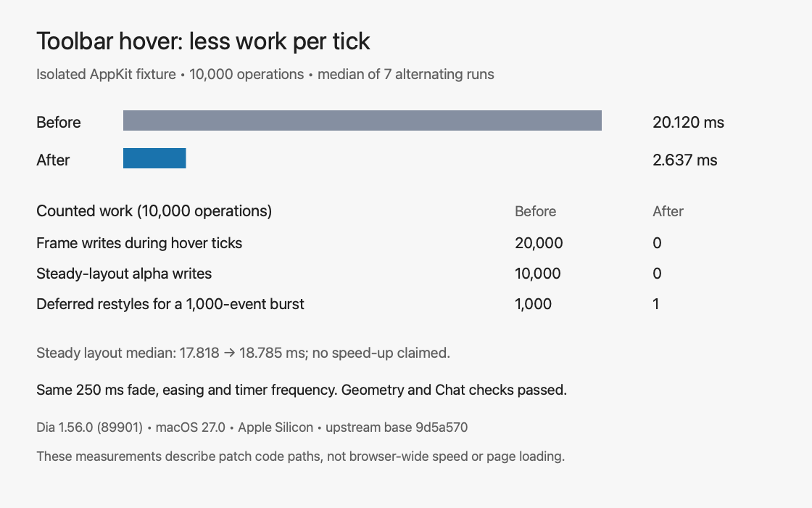

# Integration checks

Run `make test-integrations test-chatgpt` on Apple Silicon macOS. This checks generated list/custom adapters, the opt-in JavaScript runtime with synthetic mail/order/summary data, script packaging, origin routing, account/cache isolation, late callbacks, shared observation cancellation, and ChatGPT's existing collector. It does not install or relaunch Dia.

`make integration NAME=ExamplePreview ORIGIN=https://example.com` generates a starter adapter and its synthetic page/collector check. Add `CUSTOM=1` for a fully custom AppKit view. Replace the synthetic fixture and collector assertions with a minimized, anonymized example of the supported website markup as the adapter develops; do not use live account data in fixtures. See [the integration guide](../docs/tab-integrations.md).

# Toolbar and restyle performance

Run `tests/performance` on macOS with Command Line Tools installed. It builds the same AppKit fixtures against upstream base `9d5a570` and the current sources. An optional first argument selects another baseline commit.

The toolbar fixture checks page fill and restoration, opacity, stacking, reset and resizing, with flipped/unflipped coordinates and bookmarks present/absent. It measures 10,000 steady layouts and 10,000 hover ticks. The restyle fixture installs the real layout/layer/shadow hooks on stand-in views. It checks immediate styling, deferred callback counts, independent containers, later turns, and Chat opening/closing with a requested frame.

## Recorded result

[Raw samples](proof/performance.json) are from seven runs of each toolbar binary, alternating which runs first. Times are medians, in milliseconds, on Apple Silicon running macOS 27.0 (26A428). Each sample uses 10,000 operations. Run `tests/performance` first, then repeat `build/toolbar-before` and `build/toolbar-after` to collect additional samples.

| Path | Before | After |
| --- | ---: | ---: |
| Hover ticks | 20.120 ms | 2.637 ms |
| Frame writes during hover | 20,000 | 0 |
| Steady layout | 17.818 ms | 18.785 ms |
| Steady-layout alpha writes | 10,000 | 0 |
| Deferred restyles for 1,000 layout/layer events | 1,000 | 1 |

Steady layout did not speed up in this fixture. The measurable timing improvement is the opacity-only hover path. The fixtures exclude Dia's own layout work, rendering and page loading; these are not browser-wide speed measurements. Animation duration, easing and timer frequency remain unchanged.
