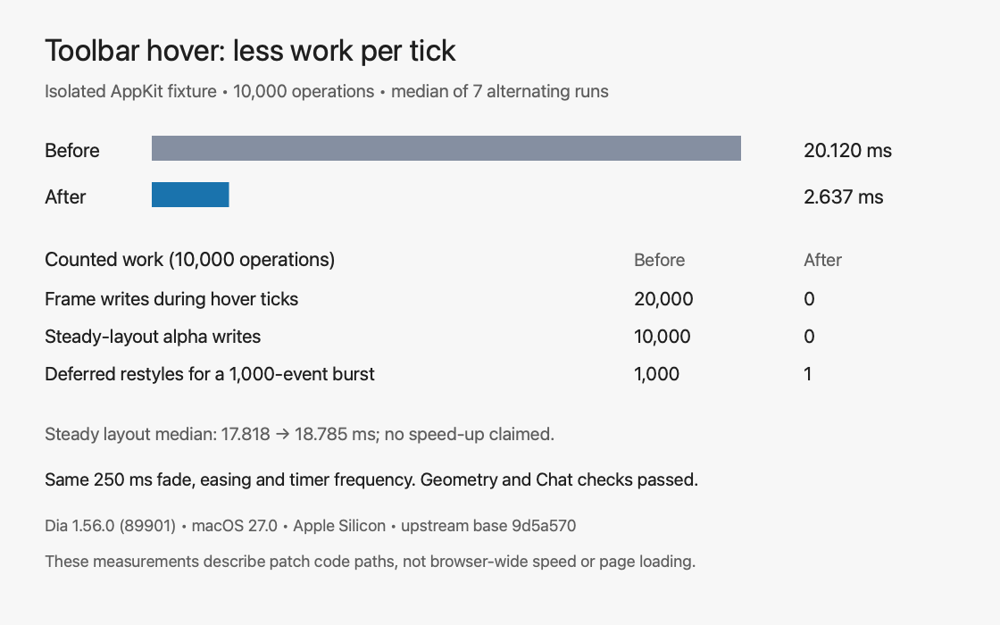

# Toolbar and restyle performance

## App switch PiP and password helpers

Run `tests/auth-and-pip` on macOS with Command Line Tools. It uses real AppKit views and the hook chain with stand-in Dia media objects, a simulated DevTools stream, and a launchctl fixture. It does not restart Dia or change your browser profile or launch agents.

It checks app deactivation with the PiP patch on/off, playing/paused/ended media, hidden tabs, existing PiP, live streams and both page geometries. The passkey test waits through the old completed document and the new loading document, and rejects a different origin. The relay test covers update registration, repair after an older updater, unloaded jobs, repeated setup, and `DIAPATCH_NO_AGENT`.

These fixtures do not prove actual video playback, Touch ID, or Apple Passwords integration. Before merging, run `make test` in Dia with both tab layouts; play a video, switch apps with the new patch on/off, and test password autofill and passkey sign-in. Record the PiP behavior for the PR and ask a maintainer to add its wiki page and preview.

## Performance fixtures

Run `tests/performance` on macOS with Command Line Tools installed. It builds the same AppKit fixtures against upstream base `9d5a570` and the current sources. An optional first argument selects another baseline commit.

The toolbar fixture checks page fill and restoration, opacity, stacking, reset and resizing, with flipped/unflipped coordinates and bookmarks present/absent. It measures 10,000 steady layouts and 10,000 hover ticks. The restyle fixture installs the real layout/layer/shadow hooks on stand-in views. It checks immediate styling, deferred callback counts, independent containers, later turns, and Chat opening/closing with a requested frame.

## Recorded result

[Raw samples](proof/performance.json) are from seven runs of each toolbar binary, alternating which runs first. Times are medians, in milliseconds, on Apple Silicon running macOS 27.0 (26A428). Each sample uses 10,000 operations. Run `tests/performance` first, then repeat `build/toolbar-before` and `build/toolbar-after` to collect additional samples.

| Path | Before | After |
| --- | ---: | ---: |
| Hover ticks | 20.120 ms | 2.637 ms |
| Frame writes during hover | 20,000 | 0 |
| Steady layout | 17.818 ms | 18.785 ms |
| Steady-layout alpha writes | 10,000 | 0 |
| Deferred restyles for 1,000 layout/layer events | 1,000 | 1 |

Steady layout did not speed up in this fixture. The measurable timing improvement is the opacity-only hover path. The fixtures exclude Dia's own layout work, rendering and page loading; these are not browser-wide speed measurements. Animation duration, easing and timer frequency remain unchanged.
